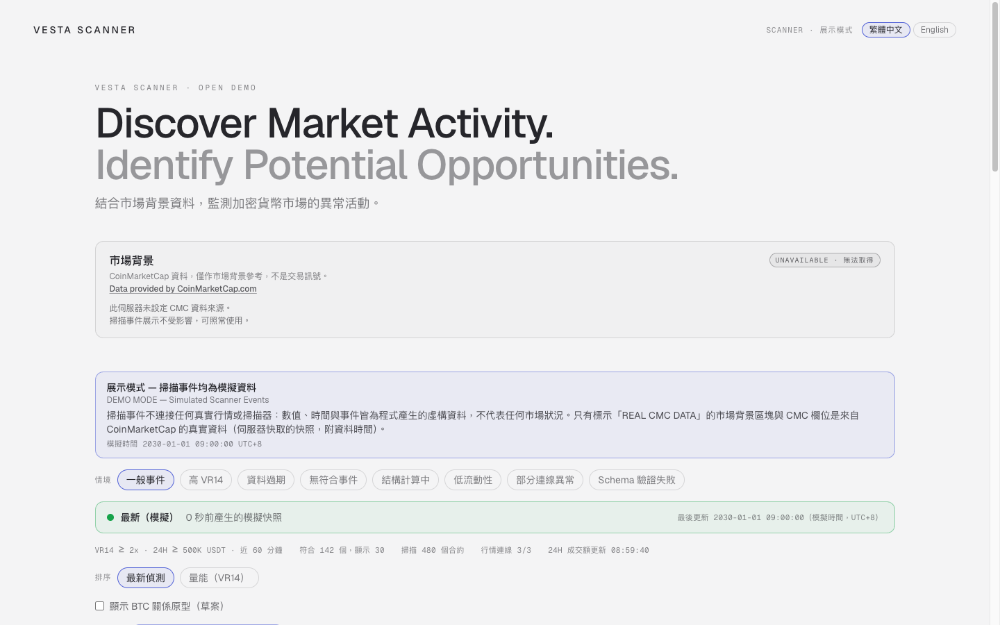
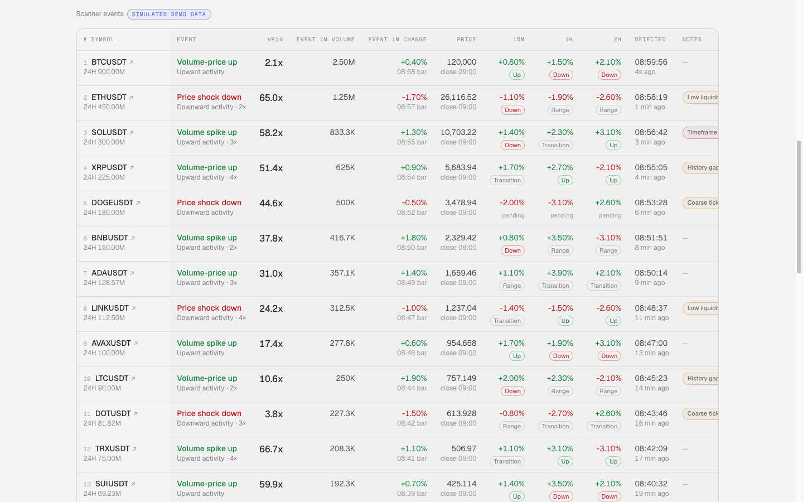
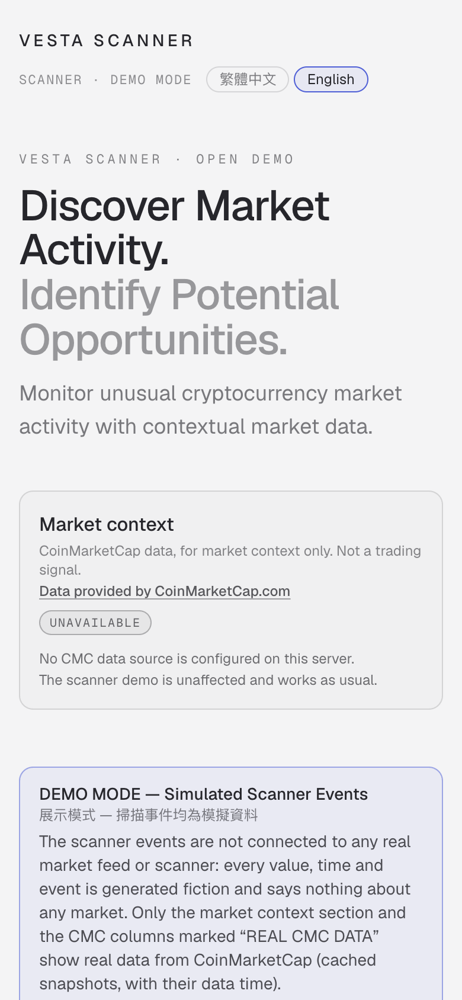

# VESTA Scanner Web

**Open-source frontend demo for crypto market activity — simulated scanner events, real CoinMarketCap market context.**
**加密貨幣市場活動的開源前端展示 — 掃描事件為模擬資料，市場背景為 CoinMarketCap 真實資料。**

*Discover Market Activity. Identify Potential Opportunities.* — a market activity intelligence tool, not a trading signal bot.

[English](#english) · [繁體中文](#繁體中文) · [License](#license--授權)

> **DEMO MODE — Simulated Scanner Events.** Every scanner event, number and time in the scanner table is fictional and generated by code. The only real data is the optional CoinMarketCap market context (labelled **REAL CMC DATA**), served as cached snapshots with their data time. This is not investment advice, and the project contains no trading functionality.
>
> **展示模式 — 掃描事件均為模擬資料。** 掃描表中的事件、數值與時間全部由程式產生、純屬虛構。唯一的真實資料是可選的 CoinMarketCap 市場背景（標示 **REAL CMC DATA**），以附資料時間的快取快照提供。不構成投資建議，也不含任何交易功能。
>
> **Free, non-commercial hackathon demo.** Built for the *Build with CMC: API Hackathon, Round 2*. It is free to use and has no accounts, ads, payments or paid features.
>
> **免費、非商業的黑客松展示。** 為 *Build with CMC: API Hackathon（第二輪）* 製作，可免費使用；沒有帳號、廣告、付款或付費功能。



<sub>Screenshot without a CoinMarketCap API key: it contains no CoinMarketCap market data. With a key, the market context panel and the CMC columns show real, cached CoinMarketCap data. 未設定 CoinMarketCap API 金鑰時的截圖，不含任何 CoinMarketCap 市場資料；設定金鑰後，市場背景區塊與 CMC 欄位會顯示經快取的 CoinMarketCap 真實資料。</sub>

---

## English

### What this is

VESTA Scanner Web is a **demonstration** of the VESTA Scanner dashboard interface. It is **not** the production VESTA Scanner: its scanner events are **simulated**, it has no detection algorithm, and it never connects to a VESTA service. Its only backend is one small server route that adds optional, cached **real CoinMarketCap market context**. It is released so developers, quantitative researchers and traders can study the interface, run it locally and propose ideas. It shows:

- **Volume-anomaly monitoring** — a ranked board of events by newest detection or by VR14 (event 1-minute volume relative to the median of the previous 14 closed 1-minute bars)
- **Multi-timeframe market structure** — 15M / 1H / 2H trend states and timeframe-conflict hints
- **Event-driven dashboard states** — fresh, delayed, partial, stopped, offline and empty states, decided from the data's age and health
- **Responsive UI** — desktop and phone layouts; the wide table scrolls inside its own box
- **Progressive Web App** — installable, with an offline page that never shows stale market data
- **Mock market scenarios** — eight reproducible scenarios, including one that deliberately fails schema validation
- **BTC relationship prototype** — an optional, clearly labelled UI draft for future research (placeholder values, see [docs/BTC_RELATIONSHIPS.md](docs/BTC_RELATIONSHIPS.md))
- **CoinMarketCap market context** *(CMC API Hackathon work)* — total crypto market cap, BTC dominance and the Fear & Greed Index, plus CMC rank, size tier, market cap, CMC 24H spot volume and 24H / 7D change next to each matched scanner row (see [CoinMarketCap integration](#coinmarketcap-integration))

### Current status

| | Status |
|---|---|
| Production VESTA Scanner | A separate, private system. Not part of this repository; nothing here connects to it |
| This repository | Public frontend demonstration; runs locally on simulated scanner data, with optional real CoinMarketCap market context |
| Scanner events | **Simulated only.** Generated by code — once at build time for the first render, then in the browser — at a simulated time starting 2030-01-01 09:00 (UTC+8). Labelled **SIMULATED DEMO DATA** |
| Market context | **Real CoinMarketCap data**, optional. Fetched only by the server route `GET /api/cmc/context`, cached there (15–60 min), and shown with the time it was fetched from CMC (`as_of`). Labelled **REAL CMC DATA**, plus **STALE** / **PARTIAL** / **UNAVAILABLE** when applicable. Without an API key the page works and shows **UNAVAILABLE** |
| BTC relationship classes | **Research proposal.** UI prototype with fixed placeholder values; no classification method is implemented or validated |

### Quick start

Requirements: Node.js **22.18 or newer** (needed to run the TypeScript tests natively) and npm.

```bash
npm install          # install dependencies
npm run dev          # development server → http://localhost:3210/demo
```

| Command | What it does |
|---|---|
| `npm run dev` | Development server on port 3210 |
| `npm run typecheck` | TypeScript check (`tsc --noEmit`) |
| `npm run lint` | ESLint |
| `npm test` | All tests (Node.js built-in test runner) |
| `npm run scan:security` | Local scan for secrets, private hosts, network calls and deployment files |
| `npm run build` | Production build |
| `npm start` | Serve the production build on port 3210 |
| `npm run check` | typecheck → lint → test → security scan → build |

No environment variables or secrets are needed to run the demo. Optionally, put a CoinMarketCap API key in a git-ignored `.env.local` (`CMC_PRO_API_KEY=...`, then `chmod 600 .env.local`) to enable the market context; it is read only on the server and never reaches the browser. To keep Next.js from sending anonymous usage data, set `NEXT_TELEMETRY_DISABLED=1`.

URL parameters: `?scenario=` one of `normal`, `high_vr14`, `stale`, `empty`, `pending`, `low_liquidity`, `partial`, `invalid`; `?lang=` `zh-Hant` or `en`. Both can also be switched in the UI.

> The service worker registers only in production builds (`npm run build && npm start`), so PWA install and offline behaviour can be tried there, not in `npm run dev`.

### Architecture

```
Browser
  └─ /demo  (Next.js page, statically rendered)
       └─ ScannerBoard (components/)
            ├─ i18n dictionary ............ lib/i18n/
            └─ ScannerDataAdapter ......... lib/data/adapter.ts
                 └─ Mock adapter .......... lib/data/mock-adapter.ts
                      ├─ Simulated clock .. lib/data/sim-clock.ts
                      ├─ Mock scenarios ... lib/mock/scenarios.ts
                      └─ Schema check ..... lib/schema/public-v2.ts  (vesta.scan.public.v2)
       └─ CmcContextPanel + CMC columns ...... components/cmc-*.tsx  (REAL CMC DATA)
            └─ same-origin GET /api/cmc/context, re-validated .. lib/data/cmc-context-client.ts

Server (Next.js route, server-only)
  └─ GET /api/cmc/context .................. app/api/cmc/context/route.ts
       └─ CMC service: fixed symbols, TTL cache, fallbacks .. lib/cmc/
            └─ HTTPS → CoinMarketCap Pro API (key from server env only)
```

Components only read data through the adapter, and every snapshot must pass the public schema before it is shown. **No production backend, database, data pipeline, detection algorithm or trading system is included.** Details: [docs/ARCHITECTURE.md](docs/ARCHITECTURE.md).

### CoinMarketCap integration

Built for the *Build with CMC: API Hackathon, Round 2*. Everything below is new; the scanner board, its simulated data and the `vesta.scan.public.v2` contract existed before and are unchanged.

| | |
|---|---|
| CMC endpoints used | `/v1/cryptocurrency/map`, `/v3/cryptocurrency/quotes/latest`, `/v1/global-metrics/quotes/latest`, `/v3/fear-and-greed/latest` |
| Where CMC is called | Only on the server (`lib/cmc/`), from `GET /api/cmc/context`. The browser only calls that same-origin route; it never contacts CoinMarketCap and never sees the key |
| What visitors can request | Nothing: the route takes no parameters. Symbols (the demo universe), CMC IDs and endpoints are fixed |
| Caching and credits | Sized to fit even the free CMC Basic plan (15,000 credits / month). Server-side cache per data source: quotes 15 min, global metrics 30 min, Fear & Greed 60 min, symbol → ID map 24 h, so at most 168 credits / day (≈ 5,040 / month) **per server process**, whatever the traffic. One request at a time per source, back-off after errors. A hard cap of **200 credits per UTC day per server process** refuses any further request (the page then shows the last good data, marked stale). Both limits are in memory, so they apply per process; several serverless instances can each spend up to the cap. Responses are `private, no-store` (no CDN or browser copy) |
| Data feed access | `GET /api/cmc/context` is the dashboard's own feed, not a public CMC data API: it answers only same-origin browser requests (`Sec-Fetch-Site: same-origin`, a header page scripts cannot set). Other websites, direct visits and clients without the header get **403** before any CMC request is made. This is a limited browser-request restriction, **not authentication** and not a guaranteed anti-redistribution control: a non-browser client can send the header itself |
| Data time | `as_of` is when the market values were fetched from CMC (the oldest of quotes, global metrics and Fear & Greed). The page shows it as "CMC snapshot as of … · cached, not real-time" |
| When CMC fails | Last good values are shown for a limited time and marked **STALE**; missing parts are marked **PARTIAL**; with nothing usable the section shows **UNAVAILABLE** and the scanner demo keeps working |
| Symbol matching | Binance contract → CMC ID, conservative: a ticker shared by several CMC assets is never guessed. The 13 such tickers in the demo universe are pinned to verified IDs; anything else unmatched shows "Not matched" |
| Coin links | A matched row's symbol opens its CoinMarketCap page (`https://coinmarketcap.com/currencies/<slug>/`), using CMC's own page name for the verified CMC ID, and only when CMC's map and quote agree on it; TradingView becomes the secondary link. Ambiguous, unmatched or unavailable rows keep the TradingView link. No extra CMC requests |
| Contract | `vesta.cmc.context.v1` (`lib/schema/cmc-context-v1.ts`), strict and validated on the server and again in the browser |
| Not included, on purpose | No futures-vs-spot volume ratio (they measure different markets), no buy / sell or long / short recommendations, no scores or predictions |

CMC 24H spot volume is CoinMarketCap's aggregated spot (CEX + DEX) volume and is **not comparable** with the contract's (simulated) 24H volume. Market data attribution, shown in the market context panel and beside the table legend whenever CMC data is displayed: [Data provided by CoinMarketCap.com](https://coinmarketcap.com).

### Screenshots

Screenshots of a local build **without a CoinMarketCap API key**, so they contain **no CoinMarketCap market data**: the market context panel shows **UNAVAILABLE** and the CMC columns are hidden. **Scanner events are simulated demo data.** With a key, the panel and the green CMC columns show real, cached CoinMarketCap data, always with its snapshot time and the attribution.

| Table: simulated events (English, no API key) | Phone (390 px, English, no API key) |
|---|---|
|  |  |

### Disclaimer

This project is an educational and research demonstration. Scanner events are simulated; the optional CoinMarketCap market context is real but cached data for reference only. Nothing in it is financial or investment advice, a recommendation, or an entry/exit signal. It has no order, account or trade-execution functionality. Crypto derivatives are highly volatile.

### Collaborating

Ideas from developers, traders and researchers are welcome:

1. **Ideas and research questions** → [open an Issue](https://github.com/vestainsight-dotcom/vesta-scanner-cmc/issues/new/choose) with the Feature request or Research proposal template. GitHub Discussions are not enabled yet; the planned categories are in [docs/COMMUNITY.md](docs/COMMUNITY.md)
2. **Bugs and agreed features** → Issues, using the templates
3. **Code** → read [CONTRIBUTING.md](CONTRIBUTING.md); starter tasks are in [docs/GOOD_FIRST_ISSUES.md](docs/GOOD_FIRST_ISSUES.md)

Where the project is heading: [docs/ROADMAP.md](docs/ROADMAP.md). Security reports: [SECURITY.md](SECURITY.md). Community standards: [CODE_OF_CONDUCT.md](CODE_OF_CONDUCT.md).

---

## 繁體中文

### 專案簡介

VESTA Scanner Web 是 VESTA Scanner 儀表板介面的**展示**，**不是** VESTA Scanner 正式版：掃描事件為**模擬資料**，不含偵測演算法，也不會連線到任何 VESTA 服務。唯一的後端是一個小型伺服器路由，提供可選、經快取的 **CoinMarketCap 真實市場背景**。開放給開發者、量化研究者與交易員研究介面、在本機執行並提出想法。內容包括：

- **成交量異常監測**：依最新偵測或 VR14（事件那根 1 分鐘成交額 ÷ 前 14 根已收盤 1 分鐘成交額中位數）排序的事件排行
- **多週期市場結構**：15M／1H／2H 趨勢狀態與週期衝突提示
- **事件驅動的儀表板狀態**：依資料新舊與健康狀態顯示最新、延遲、部分異常、停止、離線、無資料
- **響應式介面**：桌機與手機版面，寬表格在自身框內捲動
- **PWA**：可安裝；離線時顯示離線頁，不顯示過期行情
- **模擬市場情境**：八種可重現情境，其中一種刻意無法通過 schema 驗證
- **BTC 關係原型**：可開關、清楚標示的未來研究介面草案（示意值，見 [docs/BTC_RELATIONSHIPS.md](docs/BTC_RELATIONSHIPS.md)）
- **CoinMarketCap 市場背景**（*CMC API 黑客松新增*）：加密貨幣總市值、BTC 市佔率、恐懼與貪婪指數，以及對應成功的掃描列旁的 CMC 排名、規模分級、市值、CMC 24H 現貨成交額與 24H／7D 漲跌（詳見英文段落〈CoinMarketCap integration〉）

### 目前狀態

| | 狀態 |
|---|---|
| VESTA Scanner 正式版 | 獨立的私有系統，不在本儲存庫中，本專案也不會連線到它 |
| 本儲存庫 | 公開前端展示；在本機以模擬掃描資料執行，可選擇加入 CoinMarketCap 真實市場背景 |
| 掃描事件 | **僅模擬資料**，由程式產生（首次畫面於建置時產生，之後在瀏覽器中產生），使用從 2030-01-01 09:00（UTC+8）開始的模擬時間；標示 **SIMULATED DEMO DATA** |
| 市場背景 | **CoinMarketCap 真實資料**（可選）。只由伺服器路由 `GET /api/cmc/context` 取得並快取（15–60 分鐘），顯示向 CMC 取得資料的時間（`as_of`）；標示 **REAL CMC DATA**，必要時另標 **STALE**／**PARTIAL**／**UNAVAILABLE**。沒有 API 金鑰時頁面照常運作並顯示 **UNAVAILABLE** |
| BTC 關係分類 | **研究提案**。介面原型使用固定示意值，沒有實作或驗證任何分類方法 |

### 快速開始

需求：Node.js **22.18 以上**（原生執行 TypeScript 測試所需）與 npm。

```bash
npm install          # 安裝相依套件
npm run dev          # 開發伺服器 → http://localhost:3210/demo
```

其他指令：`npm run typecheck`（型別檢查）、`npm run lint`、`npm test`（全部測試）、`npm run scan:security`（本機安全掃描）、`npm run build`（正式建置）、`npm start`（在 3210 埠提供正式建置）、`npm run check`（依序執行型別檢查、lint、測試、安全掃描與建置）。

執行展示不需要任何環境變數或 secret。若要啟用市場背景，可將 CoinMarketCap API 金鑰放在已被 git 忽略的 `.env.local`（`CMC_PRO_API_KEY=...`，並執行 `chmod 600 .env.local`）；金鑰只在伺服器端讀取，不會傳到瀏覽器。若不希望 Next.js 傳送匿名使用資料，請設定 `NEXT_TELEMETRY_DISABLED=1`。

網址參數：`?scenario=`（`normal`、`high_vr14`、`stale`、`empty`、`pending`、`low_liquidity`、`partial`、`invalid`）與 `?lang=`（`zh-Hant`、`en`），也可直接在介面上切換。

> Service Worker 只在正式建置（`npm run build && npm start`）中註冊，PWA 安裝與離線行為請在正式建置中測試。

### 架構

頁面元件只透過 Data Adapter 取得資料，每份快照必須先通過公開 schema（`vesta.scan.public.v2`）驗證才會顯示。CoinMarketCap 市場背景只由伺服器路由向 CMC 取得（瀏覽器只呼叫同源的 `/api/cmc/context`），經伺服器快取並以 `vesta.cmc.context.v1` 驗證。CMC 24H 現貨成交額是 CMC 匯總的現貨（CEX + DEX）成交額，與合約的 24H 成交額（模擬）衡量不同市場，不可直接比較。**本專案不包含正式後端、資料庫、資料管線、偵測演算法或任何交易系統。** 詳見 [docs/ARCHITECTURE.md](docs/ARCHITECTURE.md)。

市場資料來源（只要顯示 CMC 資料，就會出現在市場背景區塊與表格圖例旁）：[Data provided by CoinMarketCap.com](https://coinmarketcap.com)。

已對應的幣種名稱會連到 CoinMarketCap 幣種頁面（使用 CMC 為該驗證 ID 提供的頁面名稱，且只有在 CMC 的 map 與 quote 一致時才顯示），TradingView 改為次要連結；無法唯一對應或無法取得 CMC 資料時，維持原本的 TradingView 連結。不會增加任何 CMC 請求。

### 截圖

以下為**未設定 CoinMarketCap API 金鑰**的本機建置截圖，因此**不含任何 CoinMarketCap 市場資料**：市場背景區塊顯示 **UNAVAILABLE**，CMC 欄位不顯示。**掃描事件為模擬展示資料**。設定金鑰後，市場背景區塊與綠色 CMC 欄位會顯示經快取的 CoinMarketCap 真實資料，並一律附上資料時間與來源標示。

| 表格：模擬事件（英文，未設定金鑰） | 手機（390 px，英文，未設定金鑰） |
|---|---|
|  |  |

### 免責聲明

本專案僅供教育與研究展示。掃描事件均為模擬資料；可選的 CoinMarketCap 市場背景為真實但經快取的資料，僅供參考。本專案不構成任何財務或投資建議、推薦或進出場訊號，也不具備下單、帳戶或交易執行功能。加密貨幣衍生性商品波動劇烈。

### 參與協作

1. **想法與研究問題** → 以 Feature request 或 Research proposal 範本[開 Issue](https://github.com/vestainsight-dotcom/vesta-scanner-cmc/issues/new/choose)。GitHub Discussions 尚未啟用，預計的分類見 [docs/COMMUNITY.md](docs/COMMUNITY.md)
2. **錯誤回報與已確認的功能** → 使用範本開 Issue
3. **程式碼** → 請先讀 [CONTRIBUTING.md](CONTRIBUTING.md)；入門任務見 [docs/GOOD_FIRST_ISSUES.md](docs/GOOD_FIRST_ISSUES.md)

發展方向見 [docs/ROADMAP.md](docs/ROADMAP.md)；安全回報見 [SECURITY.md](SECURITY.md)；社群規範見 [CODE_OF_CONDUCT.md](CODE_OF_CONDUCT.md)。

---

## License / 授權

Copyright 2026 VESTA Lab. Source code and documentation are licensed under the [Apache License 2.0](LICENSE); see also [NOTICE](NOTICE).

VESTA and VESTA Lab names, logos, app icons and brand artwork are **not** covered by the Apache License — see [docs/BRANDING.md](docs/BRANDING.md). Third-party software keeps its own licenses — see [docs/THIRD_PARTY.md](docs/THIRD_PARTY.md).

原始碼與文件依 [Apache License 2.0](LICENSE) 授權。VESTA／VESTA Lab 名稱、標誌、App 圖示與品牌美術**不在**授權範圍內，詳見 [docs/BRANDING.md](docs/BRANDING.md)。
